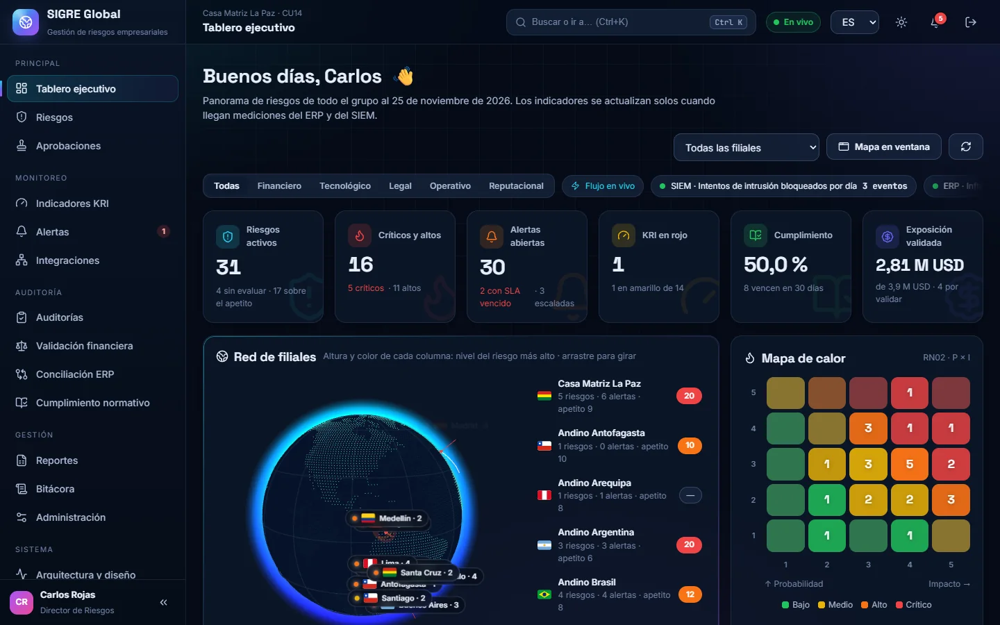

# SIGRE Global · Sistema de gestión de riesgos empresariales globales

Software del proyecto final de **INF-241 Análisis y Diseño de Sistemas** (Universidad Mayor de San Andrés, carrera de Informática). Implementa el diseño
del informe *Informe_Analisis_y_Diseno_SIGRE_Global* (versión 3): 8 actores, casos de uso CU01 a CU18,
reglas de negocio RN01 a RN18, prototipos P01 a P03 y los 26 casos de prueba del Anexo B.



## 1. Cómo iniciarlo

| Paso | Qué hacer |
|---|---|
| 1 | Doble clic en **`iniciar.bat`**. Levanta PostgreSQL (puerto 5434), la API y abre el navegador en **http://localhost:8090**. |
| 2 | En la pantalla de ingreso use el **acceso rápido de demostración**: un clic sobre una persona entra con su rol. |
| 3 | Para apagar todo: **`detener.bat`** (o cierre la ventana negra). |

Otros scripts:

* **`reiniciar-demo.bat`**: borra lo que se haya probado y vuelve a cargar el escenario de demostración. Úselo **unos 15 minutos antes de la defensa**: así la alerta crítica de RSK-TEC-0021 vence su SLA de 24 h durante la presentación y se ve el escalamiento automático (CU09).
* **`compilar.bat`**: vuelve a compilar la aplicación web y la API (solo si se cambió el código).
* **`probar.bat`**: ejecuta las pruebas automáticas CP01 a CP26 sobre la base `sigre_test`.
* `multimedia\generar_multimedia.py`: vuelve a grabar el video, los GIF y las capturas (con la aplicación encendida).

### Instalarlo en otro equipo (después de clonar el repositorio)

1. Instale **Java 21** o superior ([Adoptium](https://adoptium.net)), **PostgreSQL 16 o 17** (instalador oficial en `C:\Program Files\PostgreSQL`) y **Node.js 20** o superior. Maven ya viene en `herramientas/`.
2. Ejecute **`iniciar.bat`**. La primera vez:
   * `scripts\configurar.ps1` crea `config\bd.properties` y `config\seguridad.properties` con claves aleatorias (no se suben al repositorio);
   * `scripts\bd.ps1` crea un clúster PostgreSQL propio en el puerto 5434 (no toca el servicio del puerto 5432);
   * como no existe el jar, se ejecuta `compilar.bat` (instala las dependencias de la web y compila la API);
   * al arrancar, Flyway crea las tablas, los triggers y el escenario de demostración.
3. Se abre **http://localhost:8090**.

## 2. Usuarios de demostración

Clave de todos los usuarios de demostración: **`Sigre#2026`** (se guarda con hash Argon2id; está definida en
`backend/src/main/resources/application.yml`, propiedad `sigre.demo.clave-usuarios`).

| Usuario | Persona | Rol (actor) | Qué mostrar con este usuario |
|---|---|---|---|
| `crojas` | Carlos Rojas | Director de Riesgos (A5) | Tablero corporativo, **Aprobaciones** (CU04), riesgos críticos y aceptación (RN04, RN12) |
| `mquispe` | María Quispe | Gestora de Riesgos (A1) | Registrar (CU01), evaluar con P03 (CU02), plan (CU03), KRI y umbrales |
| `jcondori` | Jorge Condori | Responsable de Riesgo (A2) | **Mis acciones** (CU05): avance, evidencia, alertas asignadas (CU08) |
| `omendoza` | Óscar Mendoza | Responsable de Riesgo (A2) | Alerta crítica de RSK-TEC-0021 que se escala sola (CU09) |
| `pvargas` | Patricia Vargas | Auditora Interna (A3) | Plan de auditorías (CU10), hallazgos (CU11), **bitácora** y prueba de inalterabilidad (CU16) |
| `dflores` | Daniela Flores | Oficial de Cumplimiento (A4) | Normativas y obligaciones (CU12), evaluar «No cumple» → riesgo Legal (CU13, RN10) |
| `rgutierrez` | Roberto Gutiérrez | Gerente de Filial La Paz (A6) | Intentar aprobar un riesgo crítico → el sistema lo deriva al Director (RN04) |
| `lparedes` | Lucía Paredes | Gerente de Filial Perú (A6) | Solo ve los datos de Perú (RN14) |
| `admin` | Fernando Chávez | Administrador (A7) | Usuarios, roles (RN17), apetito por filial, parámetros (CU15) |
| `lmamani` | Luis Mamani | Auditor Financiero (A8) | **Validación financiera** P02 (CU17, RN16, RN17) y **conciliación con el ERP** (CU18, RN18) |

## 3. Guion sugerido para la defensa (10 minutos)

1. **Ingreso** (`crojas`): globo 3D con las 12 filiales, acceso por rol, JWT + Argon2id, doble factor TOTP opcional (Mi perfil).
2. **Tablero P01**: indicadores, globo con columnas por nivel de riesgo, mapa de calor 5×5 (clic en una celda filtra el catálogo), alertas de 30 días, «Flujo en vivo».
3. **Ciclo del riesgo** (`mquispe`): *Riesgos → Registrar riesgo*; el asistente avisa duplicados (CU01). En la ficha, **Evaluar** (P03) calcula nivel, conversión a USD (RN15) y si requiere validación (RN16). Defina el plan y propóngalo.
4. **Aprobación** (`rgutierrez` y luego `crojas`): el Gerente intenta aprobar un riesgo crítico → rechazo RN04 (queda en la bitácora como RECHAZADO). El Director ve la lista de verificación y aprueba: el riesgo pasa a EN_TRATAMIENTO.
5. **Tiempo real** (`mquispe`, *Indicadores KRI*): abra un KRI del SIEM y pulse «Simular SIEM → Rojo». El trigger pone el semáforo, genera la alerta y llega al instante (campana, centro de alertas, consola de *Integraciones*).
6. **Alertas** (`omendoza`/`jcondori`): kanban por estado con cuenta regresiva del SLA; atender → resolver (acción correctiva) → cerrar. Botón «Escalar ahora» o el escalamiento automático.
7. **Auditor Financiero** (`lmamani`): bandeja P02 con contraste del tipo de cambio del ERP; intentar validar RSK-FIN-0093 → RN17 (es responsable). *Conciliación ERP → Ejecutar*: Perú queda CON_DIFERENCIA (3,4 %) y Brasil CONCILIADA (1,2 %); registrar el hallazgo financiero.
8. **Cumplimiento** (`dflores`): evaluar una obligación con la lista de verificación; si «No cumple», nace un riesgo Legal y su alerta (RN10).
9. **Bitácora** (`pvargas`): filtros, diferencias antes/después y **Probar que es inalterable**: el rol de la aplicación no tiene permiso y el trigger bloquea incluso al dueño del esquema (RN13).
10. **Arquitectura** y **Vista móvil**: capas en ejecución, triggers, los 32 diagramas del informe, la PWA dentro de un teléfono; **Presentación** tiene el video y los GIF.

Extras para lucirse: **Ctrl+K** (buscador de riesgos y pantallas), **ventanas flotantes** (botón «Ventana» en un riesgo, «Mapa en ventana», gráfico de un KRI), tema claro/oscuro, idiomas ES/EN/PT.

## 4. Arquitectura (sección 10 del informe)

```
Navegador / PWA (React 19 + TypeScript, Three.js)
        │  HTTPS · JSON (API REST, OpenAPI en /api-docs/ui.html)      ▲ Server-Sent Events
        ▼                                                             │
API Spring Boot 3.5 (Java 21): controladores → servicios → dominio JPA (D02) · JWT, Argon2id, TOTP
        │  JDBC (rol app_rw)                                          ▲ LISTEN sigre_eventos
        ▼                                                             │
PostgreSQL 17: 21 tablas + vistas · 30 triggers con las reglas RN01–RN18 · bitácora inalterable · NOTIFY
        │
Sistemas externos (simulados): ERP corporativo · SIEM · servicio normativo · notificaciones (correo/SMS)
```

| Carpeta | Contenido |
|---|---|
| `backend/src/main/java/bo/umsa/sigre/` | Paquetes del diagrama D12: `riesgos`, `monitoreo`, `auditorias`, `cumplimiento`, `reportes`, `administracion`, `seguridad`, `integraciones`, `comun` |
| `backend/src/main/resources/db/migration/` | Flyway: `V1` esquema, `V2` funciones y triggers, `V3` roles y permisos, `V4` datos base, `V5` escenario de demostración |
| `backend/src/test/` | `CasosDePruebaTest`: CP01 a CP26 de punta a punta (HTTP → servicio → trigger) |
| `frontend/src/` | `paginas/` (una por pantalla), `componentes/` (globo 3D, carruseles, gráficos, ventanas), `nucleo/` (API, sesión, eventos, idiomas) |
| `frontend/public/diagramas/` | Las 32 figuras del informe (galería de *Arquitectura*) |
| `frontend/public/medios/` | Video MP4, GIF y capturas de la *Presentación* |
| `scripts/` | `bd.ps1` (clúster PostgreSQL: `iniciar`, `detener`, `estado`, `reiniciar-datos`, `consola`), `configurar.ps1`, `java.ps1` |
| `multimedia/` | `generar_multimedia.py`: graba el video, los GIF y las capturas con Playwright |
| `config/` | Conexión a la base y clave de firma JWT: se generan en cada equipo y no se versionan |

### Reglas que garantiza la base de datos

| Trigger | Regla |
|---|---|
| `trg_riesgo_antes_insertar` | Código RSK-CAT-####, título único por filial (CU01), responsable con acceso (RN14) |
| `trg_riesgo_transicion` | Estados del riesgo (D08) y condición de MITIGADO (RN11) |
| `trg_evaluacion_antes_insertar` | Nivel P×I (RN02), vigencia 12 meses (RN03), conversión a USD (RN15), validación requerida (RN16) |
| `trg_plan_antes_actualizar` | RN03, RN04, RN05, RN12, RN16 y separación de funciones al aprobar (CU04) |
| `trg_accion_antes` | Avance que no disminuye y evidencia obligatoria (CU05) |
| `trg_medicion_antes/despues` | Semáforo (RN06) y alerta automática (CU07) |
| `trg_alerta_transicion` | Estados de la alerta (D09), SLA (RN07), acción correctiva (CU08) |
| `chk_independencia` | El auditor no valida riesgos propios (RN17) |
| `trg_conciliacion_antes/despues` | Tolerancia de la conciliación y alerta de diferencia (RN18) |
| `trg_eval_cumplimiento_despues` | «No cumple» crea el riesgo Legal (RN10) |
| `trg_usuario_rol_sod` | Auditor Financiero y Gestor no se combinan (RN17) |
| `trg_auditar` (19 tablas) | Bitácora con valores antes y después (RN13) |
| `trg_bitacora`, `trg_bitacora_truncate` | La bitácora solo admite inserciones (RN13) |

## 5. Pruebas

`probar.bat` ejecuta los 26 casos del Anexo B como pruebas de integración (JUnit 5 + MockMvc) contra la
base `sigre_test`, que se vacía y se recrea con Flyway en cada corrida. Resultado esperado:
`Tests run: 26, Failures: 0, Errors: 0`.

## 6. Problemas frecuentes

* **El puerto 8090 está ocupado**: ejecute `detener.bat` y vuelva a iniciar.
* **La base no arranca**: `powershell -ExecutionPolicy Bypass -File scripts\bd.ps1 -Accion estado` muestra el estado; los datos están en `%LOCALAPPDATA%\SIGRE-Global\pgdata`.
* **Quiero ver la API**: http://localhost:8090/api-docs/ui.html (pida el token en `/api/auth/login` y péguelo en *Authorize*).
* **Abrirlo en el teléfono**: con el equipo y el teléfono en la misma red, abra `http://IP-DEL-EQUIPO:8090` y elija «Agregar a la pantalla de inicio».
